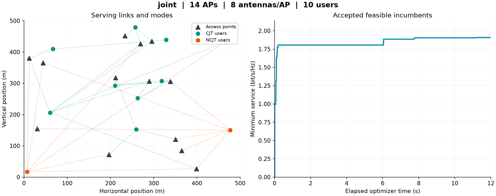

<p align="center">
  
</p>

<p align="center">
  <a href="https://github.com/Devchandrasen/cellfree-resource-optimizer/actions/workflows/ci.yml"></a>
  
  
  
</p>

<p align="center">
  <a href="#quick-start">Quick start</a> ·
  <a href="docs/configuration.md">Configuration</a> ·
  <a href="docs/methods.md">Methods</a> ·
  <a href="docs/experiments.md">Experiments</a> ·
  <a href="docs/architecture.md">Architecture</a>
</p>

# CellFree Resource Optimizer

A simulation toolkit for deciding which access points serve each user, how they transmit and how shared power and fronthaul resources are allocated.

The package combines statistical channel generation, coherent and noncoherent serving modes, constrained numerical solvers and independent feasibility checks. Every method starts from physical network inputs and receives its own runtime budget.

| Network generation | Resource allocation | Verification |
| :--- | :--- | :--- |
| Correlated Rayleigh channels and finite MMSE estimates | Joint AP selection, user modes, power and payload flows | Independent checks of the returned allocation |
| Periodic deployments with spatially correlated shadowing | Seven methods with a common acceptance deadline | NumPy and MATLAB validation |
| Configurable APs, antennas, user loads and link capacities | Clarabel conic solves and HiGHS linear and mixed-integer solves | Portable files, input hashes and environment records |

## Quick start

Python 3.11 or later is required. A GPU is not required.

```bash
git clone https://github.com/Devchandrasen/cellfree-resource-optimizer.git
cd cellfree-resource-optimizer
python -m venv .venv
```

Activate the environment:

```bash
# macOS / Linux
source .venv/bin/activate
```

```powershell
# Windows PowerShell
.\.venv\Scripts\Activate.ps1
```

Install and run a small example:

```bash
python -m pip install -e ".[plots]"
cellfree run --config examples/small.json --method joint --seconds 5 --output runs/demo --plot
cellfree validate runs/demo
```

The default configuration uses 14 APs, eight antennas per AP and ten users:

```bash
cellfree run --config examples/default.json --method joint --seconds 60 --output runs/default --plot
```

Each command needs a new output directory. Existing results are never silently overwritten.

## A look inside a run

<p align="center">
  
</p>

This view comes from a fresh example with layout seed 7 and a 12 second optimizer budget. It illustrates the software outputs. Its trajectory and final value depend on processor speed and the numerical environment.

<p align="center">
  
</p>

## Available methods

| CLI name | Serving modes | AP association |
| :--- | :--- | :--- |
| `joint` | Coherent, noncoherent or mixed | Coupled mode and AP moves |
| `strong-cjt` | Coherent only | Capacity-aware AP search |
| `mode-informed-cjt` | Coherent only | Additional mode-informed AP proposals |
| `pure-ncjt` | Noncoherent only | Independent AP and payload search |
| `adaptive-pure` | Chooses one pure mode for all users | Independently budgeted endpoint search |
| `fixed-hybrid` | Coherent, noncoherent or mixed | Fixed strongest-gain AP sets |
| `swap-switch` | Coherent, noncoherent or mixed | User swaps, switches and AP refinements |

The objective is the smallest delivered service across users, in bit/s/Hz. The packaged association controllers use unit service weights. They are finite-budget heuristics and do not promise global optimality or a gain on every layout.

## Python API

```python
from cellfree_optimizer import NetworkConfig, generate_network, optimize

config = NetworkConfig(
    aps=14,
    antennas=8,
    users=10,
    max_aps=8,
    fronthaul=4.0,
    seed=7,
)
network = generate_network(config)
result = optimize(network, method="joint", seconds=60, seed=0)

print(result.service)
print(result.validation["max_residual"])
print(result.solution["A"])  # AP-user association
print(result.solution["z"])  # True: CJT, False: NCJT
```

Network generation is separate from optimization, so several methods can receive exactly the same channel statistics and capacities.

## Matched experiments

```bash
cellfree benchmark --config examples/default.json --methods joint,strong-cjt,pure-ncjt,fixed-hybrid,swap-switch --layouts 5 --seeds 2 --seconds 60 --output runs/comparison
cellfree report runs/comparison
```

Fronthaul and association limits can be swept together:

```bash
cellfree benchmark --config examples/default.json --methods joint,strong-cjt --fronthaul 2,4,8 --max-aps 4,8 --layouts 5 --seeds 2 --seconds 60 --output runs/grid
```

The runner shuffles method order deterministically within each matched block. Seeds are grouped within layouts when paired gains and pointwise intervals are calculated. See [experiment guidance](docs/experiments.md) before running a long batch.

## What gets saved

```text
runs/demo/
├── network.npz       Physical inputs, configuration and positions
├── solution.npz      Association, modes, amplitudes and payload rates
├── validation.mat    Independent MATLAB-checkable export
├── result.json       Timing, residuals, trace, hashes and environment
├── overview.svg      Optional vector overview
└── overview.png      Optional image overview
```

MATLAB checks run with:

```matlab
addpath('matlab');
report = validate_export('runs/demo/validation.mat');
```

Optimization uses Python and native numerical solvers. MATLAB is an independent validator and requires no optimization toolbox.

## Model and runtime contract

The implementation uses statistical MRT precoding, orthogonal pilots and a fixed ideal successive-cancellation order. Fronthaul capacities account for user payload forwarding. Synchronisation overhead, pilot contamination and imperfect cancellation are outside the supplied model.

The acceptance clock includes association-template construction, all data-dependent initialization, graph and mode proposals, solver assembly and candidate checks. Imports and physical network generation precede that clock. A native solver may return late, but a late candidate cannot replace the retained incumbent. Both elapsed time and acceptance time are recorded.

## Development

```bash
python -m pip install -e ".[dev]"
python -m ruff check .
python -m ruff format --check .
python -m pytest
python -m build
```

Continuous integration covers Windows and Linux with Python 3.11 and 3.12. The tests check analytical channel moments, rate identities, deliberately invalid allocations, file interoperability, serving-mode restrictions and acceptance deadlines.

See [contributing](CONTRIBUTING.md), [release notes](CHANGELOG.md) and the [tested dependency snapshot](requirements-tested.txt). The snapshot records one tested environment. `pyproject.toml` defines the supported dependency ranges.

---

Maintained by **Chandrasen Pandey** · [GitHub](https://github.com/Devchandrasen)

Copyright © 2026 Chandrasen Pandey. All rights reserved. See [NOTICE](NOTICE).
